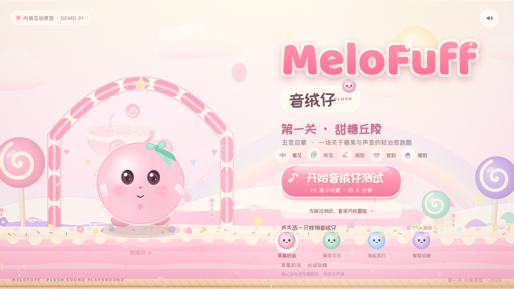
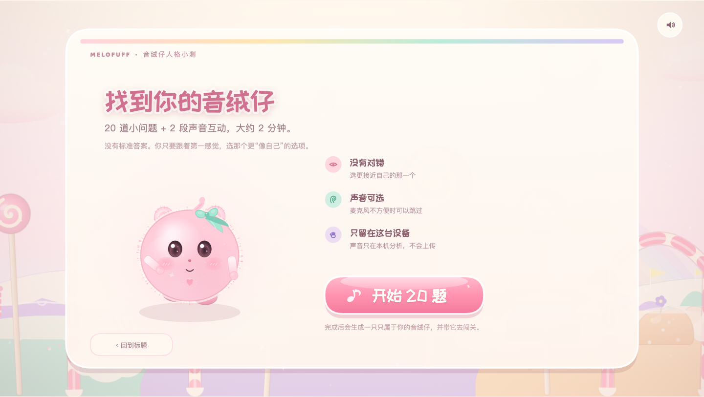
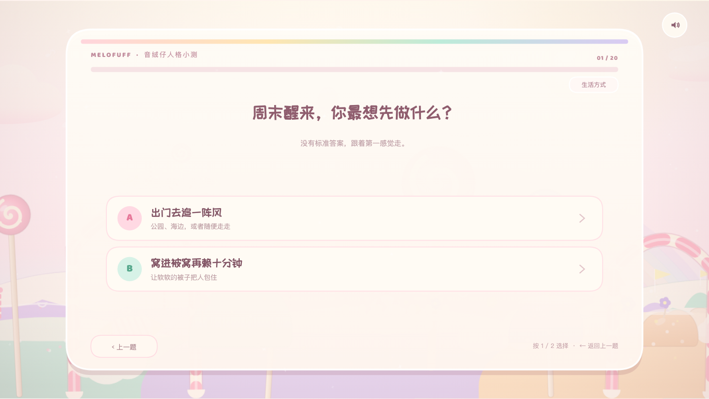
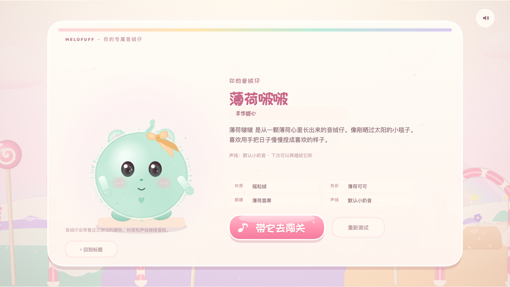
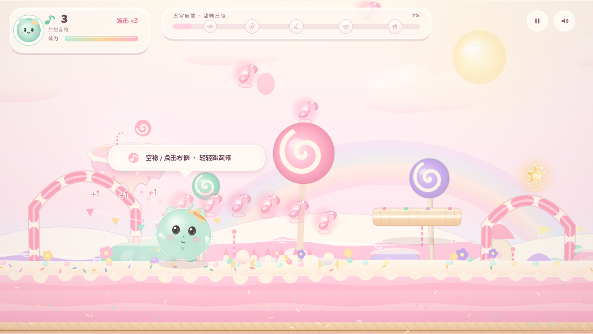
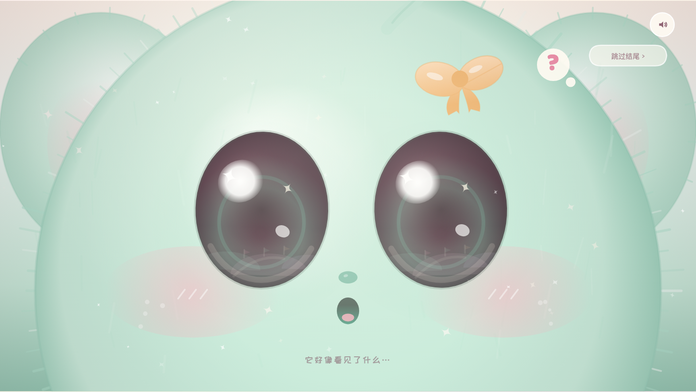

# MeloFuff 音绒仔 · 第一关「甜糖丘陵」

MeloFuff 是一个把人格测评、声音采集、专属毛绒形象与轻治愈跑酷音游串在一起的全新文创互动项目。
本次内测交付的是 **可独立游玩的完整原型**：先做一套 20 道的人格小测和两段可选的声音互动，生成一只专属于你的音绒仔；然后带它进入糖果山丘，随着《冰晶果冻跑酷》的节拍奔跑、跳跃、接住音符，穿过果冻河，抵达糖果城门，最后看见远远近近、好多好多正在等它的关卡。



## 立即体验

最简单的打开方式：

1. 双击 `index.html`，推荐用 Chrome 打开。
2. 点击 **「开始音绒仔测试」**，完成 20 道小问题；两道声音题可以跳过。
3. 在结果页点击 **「带它去闯关」**，进入第一关。

不想做题时，可以点标题页下方的 **「先跳过测试，直接开始冒险」**，用现有的样例音绒仔直接进入关卡。浏览器要求先点击一次，才会播放关卡音乐。

如果浏览器对本地音频或麦克风有限制，也可以在项目目录里启动一个本地静态服务：

```bash
cd MeloFuff
python3 -m http.server 8080
```

然后访问 <http://localhost:8080>。

> 推荐横屏游玩。手机竖屏时可以玩，但顶部会提示横屏体验更佳。
>
> 浏览器麦克风权限需要安全上下文。双击本地 `index.html` 时部分浏览器会禁用麦克风，这种情况直接用「跳过声音题」即可；想完整测试声音题，建议用上面的本地静态服务打开。

## 操作

| 操作 | 键盘 | 触屏 / 鼠标 |
| --- | --- | --- |
| 跳跃 / 二段跳 | `Space` / `↑` / `W` | 点右侧「跳」，或点击画面 |
| 长按跳得更高 / 气球滑翔 | 长按跳跃键 | 长按「跳」 |
| 减速 | `←` / `A` | 点左侧「慢」 |
| 轻微加速 | `→` / `D` | — |
| 暂停 / 继续 | `P` / `Esc` | 点右上角暂停 |
| 静音 | `M` | 点右上角小喇叭 |
| 重新开始 | `R` | 暂停菜单里的「重新开始」 |
| 换一只音绒仔 | 标题页 `1` ~ `4` | 点标题页的四个小毛球 |
| 测试选择选项 | `1` / `2` 或 `A` / `B` | 点选项 |
| 测试返回上一题 | `←` / `Backspace` | 点「上一题」 |
| 跳过声音题 | — | 点「跳过声音题」 |

## 音绒仔测试



测试一共 **20 步**：

- 18 道趣味选择题，覆盖运动偏好、居家手工、社交能量、审美、音乐口味、材质手感、独处方式、此刻心情等维度；
- 2 道可选声音题：
  - 四句小诗朗读（最多 20 秒）；
  - 30 秒自由哼唱，不想唱也可以随时跳过。

声音只在这台设备上用 Web Audio 做轻量分析（音量、音高变化、有声比例），不会上传、不会保存录音。声音特征会轻轻影响音绒仔的材质、节奏感与眼睛高光。



完成后会从 **8 个色系方向、5 种毛绒材质、6 种性格原型**中生成一只专属音绒仔，包括：

- 专属昵称，例如「莓莓软云」「樱樱月」；
- 专属配色、毛绒长度、光泽、蝴蝶结、眼睛颜色；
- 一句性格描述和声线标签；
- **「带它去闯关」**：结果会同步到 HUD 头像、跑酷角色和结尾眼睛特写里。



测试结果也会保存在当前页面状态中；回到标题页后，角色仍是你的专属音绒仔，并会显示「测试专属」标记。点四个样例毛球可以随时换回预设。

部署到 GitHub Pages 后，除了 `?scene=quiz`，项目里还带了一个更适合分享的直达入口：

```text
https://<你的站点>/quiz/
```

它只是一个很轻的跳转页，会立刻打开测试；页面标题也会显示“MeloFuff 音绒仔测试”。

## 这一关里有什么



- **58 秒完整糖果关卡**：开始 → 跑酷 → 五官启蒙里程碑 → 糖果城门 → 结尾动画。
- **节奏化音符**：漂浮音符按 108 BPM 随节拍落下，另有固定音符拱桥。音符会补体力、积攒甜度。
- **轻加速状态**：甜度到 30 个音符进入「轻快」，到 75 个进入「飞扬」，角色光效、速度与跳跃手感都会变化。
- **四种糖果道具**：
  - 跳跳糖弹簧：踩上去弹得很高；
  - 葡萄果冻磁铁：8 秒内把附近音符吸过来；
  - 棉花糖气球：多一次跳跃，长按还能慢慢飘；
  - 幸运棒棒糖：直接 +12 音符。
- **五官启蒙里程碑**：眼睛、耳朵、鼻子、嘴巴、手的五枚徽章，会随着旅程依次亮起。
- **果冻河与棉花糖云救援**：没有硬核死亡。掉进果冻河，会被一朵打瞌睡的棉花糖云接住，送回对岸。
- **软糖障碍**：撞到只会软软地晃一下、掉连击，不会被判失败；从上方踩到还会弹起来。
- **结尾动画**：闯关成功后镜头推近，音绒仔定睛看见眼睛里的远方；随后远景展开——糖霜丘陵、彩虹、热气球的远处，是一道又一道编着号码的糖果关卡门，最后出现：

  > **更多冒险，等你！**

  

  

- **四只可换装的音绒仔**：草莓奶油（丝绒软糯）、薄荷可可（羊毛蓬松）、海盐苏打（短绒哑光）、葡萄软糖（羊羔绒）。不同配色会同步到眼睛、蝴蝶结、道具光效和结尾动画里。

## 项目结构

```text
MeloFuff/
├── index.html
├── quiz/index.html    # 测试专属分享入口，跳转到 ?scene=quiz
├── css/style.css
├── js/
│   ├── util.js        # 绘图、色彩、缓动、随机与 UI 基础工具
│   ├── audio.js       # 音乐播放、节拍时钟、合成音效
│   ├── character.js   # MeloFuff 毛绒球动画、表情与眼睛特写
│   ├── world.js       # 糖果背景、地面、平台、道具、音符与城门
│   ├── scenes.js      # 标题页、结算 HUD 元件、结尾电影镜头
│   ├── quiz.js        # 20 题测试、声音采集、结果与专属音绒仔生成
│   └── game.js        # 状态机、物理、收集、HUD、输入与主循环
├── assets/
│   ├── audio/candy-jelly-run.mp3
│   └── fonts/         # ZCOOL KuaiLe、Baloo 2（均附 OFL 许可）
├── docs/
└── README.md
```

纯 HTML5 Canvas + 原生 JavaScript，无构建步骤、无外部 CDN 依赖。所有糖果场景、角色、平台、图标均为本次项目原创绘制。

## 实现说明

- 关卡使用 **108 BPM** 的节拍网格，音符落点与音乐同步；关卡结束点对齐原曲 76 秒处的段落转折。
- 跑酷采用自动前进 + 手动跳跃/减速/加速，专为线下市集与移动端触摸做了简化。
- 跳跃有土狼时间、按键缓冲、二段跳、可变跳跃高度与落地下压回弹。
- 无失败态：体力低只会变慢，掉河只损失一点体力与连击，符合温柔治愈的调性。
- 全部图形在 Canvas 中程序化绘制，背景层预渲染；同时带自适应渲染分辨率，优先保证低性能设备上的流畅稳定。
- 结尾使用低通滤波 + 音量自动化，让音乐从跑酷段落柔和地过渡到揭示段落。
- 测试结果由轻量规则生成：答案落在 7 个性格维度上，再与 8 个色系、5 种材质、6 种性格原型做匹配；声音节奏会额外影响材质与眼睛高光。
- 麦克风录音只用 `getUserMedia` + `AnalyserNode` 做本地采样，结束后立刻停止音轨、关闭音频上下文。

## 内测调试参数

这些参数用于现场调试和截图，普通游玩不需要：

- `index.html?scene=play`：跳过标题直接开始；
- `index.html?scene=quiz`：直接进入音绒仔测试；
- `index.html?scene=ending&et=12`：直接查看结尾的某一个时间点；
- `index.html?skin=2`：指定初始音绒仔配色（0–3）；
- 控制台里可以访问 `window.__MELO__`，例如 `__MELO__.startRun()`、`__MELO__.debugEnding(10)`。

## 部署到 GitHub Pages

整个项目是纯静态文件，不需要构建。把 **整个 `MeloFuff` 文件夹的内容**上传到 GitHub 仓库后：

1. 仓库 **Settings → Pages**；
2. **Build and deployment → Source** 选 **Deploy from a branch**；
3. Branch 选 **main**，目录选 **/(root)**，保存；
4. 等 1–2 分钟，Pages 设置页会显示正式地址。

地址规律是：

```text
主体验页面：https://<用户名>.github.io/<仓库名>/
测试直达页：https://<用户名>.github.io/<仓库名>/quiz/
测试直达参数：https://<用户名>.github.io/<仓库名>/?scene=quiz
```

例如仓库名是 `MeloFuff1.0`、用户名是 `MoSi-MoMo` 时：

```text
https://mosi-momo.github.io/MeloFuff1.0/quiz/
```

如果希望分享链接更短，建议把仓库名改成小写的 `melofuff`，即可得到：

```text
https://mosi-momo.github.io/melofuff/quiz/
```

如果使用自定义域名，也可以配置成 `https://test.melofuff.com/` 或 `https://melofuff.com/quiz/`。GitHub Pages 默认是 HTTPS，麦克风权限在 HTTPS 下可以正常请求。

> 注意：GitHub 仓库链接本身是代码页面，不是可玩的游戏；只有启用 Pages 后，上面的 `github.io` 地址才会出现。

## 已知边界（内测原型）

- 本次交付包含标题页、20 题测试/声音互动、第一关跑酷与结尾流程。完整产品中的 70+ 色系、15 种毛绒材质与更细的眼睛形状匹配还没有全部接入；当前测试会从 8 个色系方向、5 种材质、6 种性格原型里生成专属结果。
- 声音分析是轻量原型的版本：用音量、音高变化和有声比例做趋势匹配，不等同于专业的音色/情绪声学分析。录音不会保存或上传。
- 部分浏览器在 `file://` 下会禁用麦克风；这时用「跳过声音题」即可完成测试，或按上面的方式启动本地静态服务后再体验录音。
- 建议使用 Chrome / Edge / Safari 的近两年版本；如果在某些内嵌浏览器中音乐没有自动开始，点击画面或静音按钮一次即可唤醒音频。
- 竖屏手机会保留完整 16:9 舞台，因此画面偏小，建议横屏。

## 素材与致谢

- 关卡音乐：《冰晶果冻跑酷》超凡脱俗的卡布奇诺-电子（由项目方提供，用于本次内测演示）。
- 字体：[ZCOOL KuaiLe](https://fonts.google.com/specimen/ZCOOL+KuaiLe)、[Baloo 2](https://fonts.google.com/specimen/Baloo+2)，SIL Open Font License，许可文件保存在 `assets/fonts/`。
- 糖果场景、音绒仔角色、UI 图标、特效与代码：MeloFuff 原型原创实现。糖果题材参考了经典糖果乐园的甜美气质，但未使用任何既有 IP 的角色、场景或素材。

---

**MeloFuff · 第一关内测原型 · 2026**
